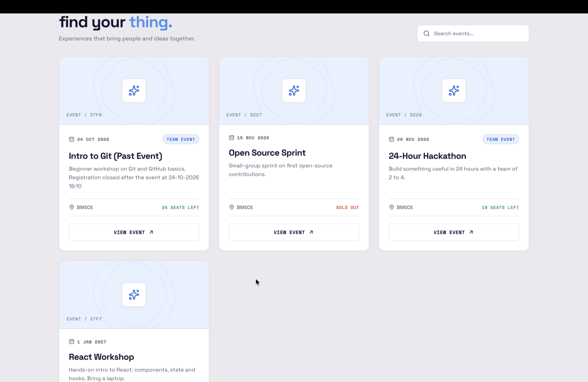
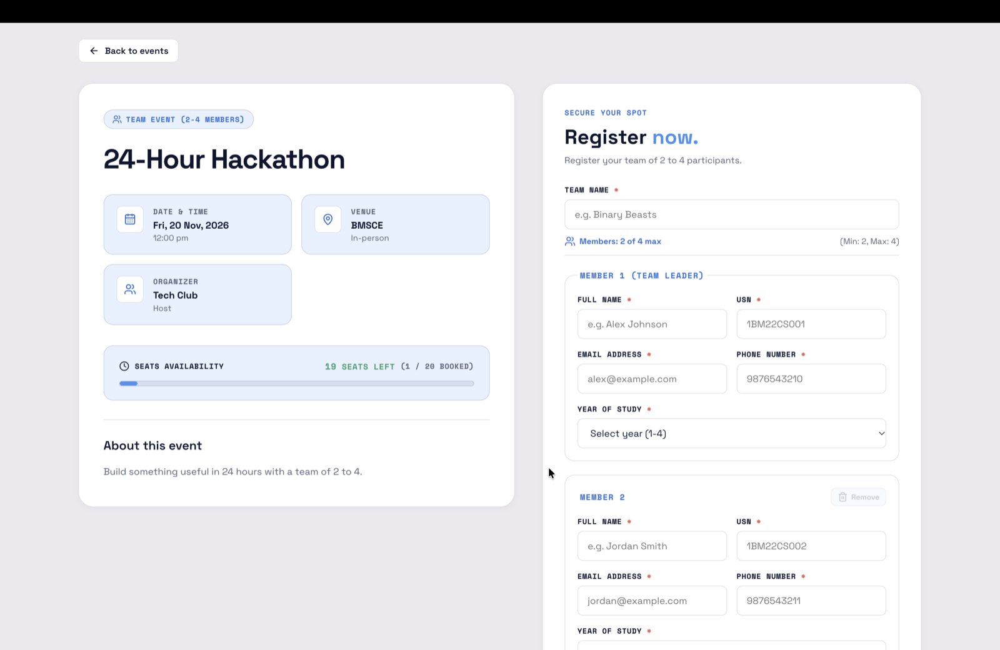
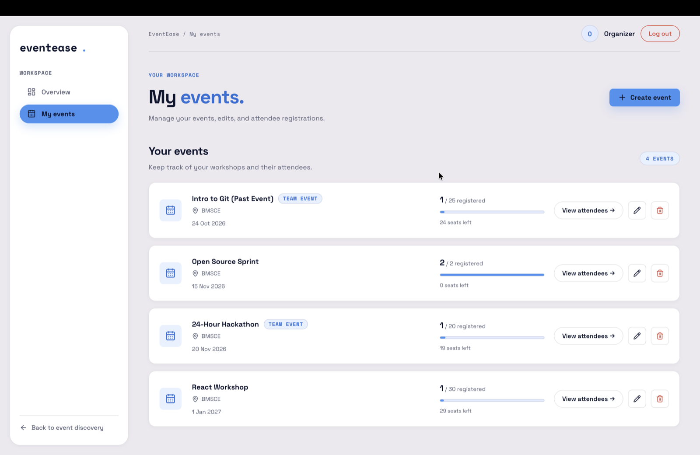
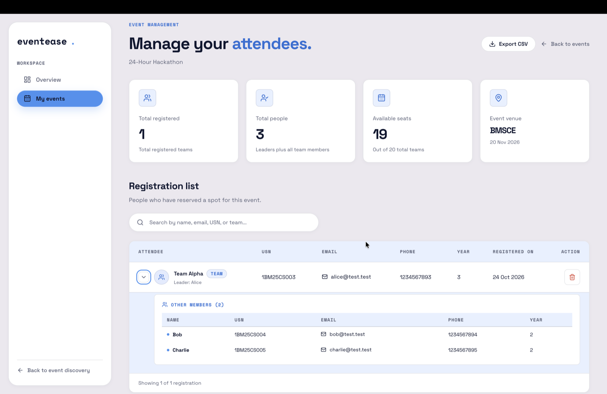

# EventEase — Event Management Platform

EventEase is a full-stack event management application built with the MERN stack. It allows users to discover events and register for available seats, while authenticated organizers can create and manage their events through a dedicated dashboard.

**Live demo:** https://event-ease-three-tau.vercel.app/

**Backend API:** https://eventease-api-hyd3.onrender.com

**Repository:** https://github.com/dharyagoyal/EventEase

> The backend runs on Render's free tier, so the first request after a period of inactivity can take up to a minute. If events don't load right away, wait a moment and refresh.

## Screenshots

**Home**


**Event discovery**



**Team registration form**



**Organizer dashboard**



**Attendee management with team breakdown and CSV export**



## Organizer Access

Browsing events, viewing details and registering are public and need no login. The organizer dashboard requires an organizer account, which is not shared publicly. The screenshots above show the dashboard, and you can try it yourself by running the project locally and creating an organizer account (see [Getting Started](#getting-started)).

## Features

### Event Discovery and Registration
- Browse available events with real-time search.
- Full event details page (`/events/:id`) displaying schedule, venue, organizer, capacity, and remaining seats.
- Extended registration form capturing student details: name, email, USN (University Seat Number), phone number, and year of study (1–4).
- Team events with variable team size: team registrations with configurable team sizes (2–10 members), team name, leader details, and dynamic member inputs.
- Prevent duplicate registrations for the same event (validating both email and USN across solo attendees, leaders, and team members).
- Enforce event capacity and track remaining seats in real time. Events at capacity are shown as sold out and block further registration.
- Registration closes automatically once an event's start time has passed.
- Validate event details and registration requests.

### Organizer Dashboard
- Organizer login using JWT-based authentication.
- Analytics overview: workspace summary displaying total events, total registrations, and total seats remaining.
- Per-event stats: breakdown for each event including capacity, registered count, remaining seats, and fill percentage.
- Dedicated events management route (`/dashboard/events`) to view, create, edit, and delete events.
- Team event configuration: create and edit events with configurable team sizes (`minTeamSize` and `maxTeamSize` from 2 to 10).
- View and remove attendees for events owned by the authenticated organizer, with team role breakdown.
- Real-time seat recalculation and capacity updates upon attendee removal.
- CSV export: export attendee lists as CSV (`GET /events/:id/attendees/export`) with sanitized cells, leader/member roles, USN, contact info, and registration dates.
- Log out and protect dashboard routes from unauthenticated access.

### Frontend Routes
- `/` — Public event exploration and search
- `/events/:id` — Full event details page with registration form
- `/login` — Organizer login
- `/dashboard` — Organizer dashboard with analytics overview and per-event stats
- `/dashboard/events` — Organizer events management (create, edit, delete events)
- `/dashboard/events/:id` — Event attendees roster with CSV export and attendee removal

### Security and Authorization
- Password hashing using bcrypt.
- JWT-based authentication with token expiration.
- Protected organizer management endpoints.
- Event ownership checks for updates, deletion, and attendee removal.
- Owner-only access to view, export, and remove attendees.
- Input validation for event, attendee removal, and registration requests.

## Tech Stack

| Layer | Technologies |
|---|---|
| Frontend | React, Vite, React Router, CSS |
| Design | Custom CSS design system (light theme), Space Grotesk and Space Mono |
| Backend | Node.js, Express.js |
| Database | MongoDB, Mongoose |
| Authentication | JSON Web Tokens (JWT), bcryptjs |
| Frontend hosting | Vercel |
| Backend hosting | Render |
| Database hosting | MongoDB Atlas |

## Design

The interface is a hand-written CSS design system with no UI framework. Design tokens live as CSS variables at the top of `client/src/App.css`: colors, type scale, spacing, radii, and shadows.

- **Palette:** Blue Energy `#4392F1`, Lavender Mist `#ECE8EF`, Lavender `#E3EBFF`, Alice Blue `#E7F0FF`, and Cinnabar `#DC493A` for destructive actions and errors.
- **Typography:** Space Grotesk for headings and body text, Space Mono for labels, navigation, and badges.
- **Public pages:** editorial layout with large lowercase display type and hairline rules.
- **Organizer dashboard:** soft rounded cards, a floating sidebar, and pill-shaped controls.
- **States:** dedicated designs for sold-out events, closed registration, and form validation errors.

## Architecture

```text
                 ┌──────────────────────┐
                 │      React UI        │
                 │ Vite + React Router  │
                 └──────────┬───────────┘
                            │ HTTP / REST API
                            ▼
                 ┌──────────────────────┐
                 │    Express Server    │
                 │ Authentication       │
                 │ Authorization        │
                 │ Validation           │
                 └──────────┬───────────┘
                            │ Mongoose
                            ▼
                 ┌──────────────────────┐
                 │      MongoDB         │
                 │ Users, Events,       │
                 │ Registrations        │
                 └──────────────────────┘
```

## Project Structure

```text
eventease/
├── client/
│   ├── src/
│   │   ├── components/
│   │   ├── context/
│   │   ├── pages/
│   │   └── utils/
│   ├── .env.example
│   └── package.json
├── server/
│   ├── src/
│   │   ├── controllers/
│   │   ├── middleware/
│   │   ├── models/
│   │   └── routes/
│   ├── .env.example
│   └── package.json
├── docs/
│   └── screenshots/
├── .gitignore
└── README.md
```

## Getting Started

### Prerequisites

- Node.js and npm
- A MongoDB database, such as MongoDB Atlas
- Git

### 1. Clone the repository

```bash
git clone https://github.com/dharyagoyal/EventEase.git
cd EventEase
```

### 2. Configure the backend

```bash
cd server
npm install
```

Create a `.env` file in the `server/` directory using `.env.example` as a reference.

Configure the required environment variables:

```env
PORT=5000
MONGODB_URI=your_mongodb_connection_string
JWT_SECRET=your_strong_random_secret
CLIENT_URL=http://localhost:5173
```

Use the exact database variable name specified in `server/.env.example` if it differs from `MONGODB_URI`.

Generate a strong JWT secret locally rather than using a placeholder:

```bash
openssl rand -base64 48
```

Start the backend:

```bash
npm run dev
```

The API runs on `http://localhost:5000` by default.

### 3. Configure the frontend

Open a second terminal from the project root:

```bash
cd client
npm install
```

Create a `.env` file in `client/` using `.env.example` as a reference.

Configure the API base URL:

```env
VITE_API_URL=http://localhost:5000/api/v1
```

Start the frontend:

```bash
npm run dev
```

Open the local URL printed by Vite, usually `http://localhost:5173`.

### 4. Organizer account

The frontend provides an organizer login screen (`/login`). To create an organizer account for local testing, send a `POST` request to the registration endpoint with your own test credentials:

```bash
curl -sS -X POST http://localhost:5000/api/v1/auth/register \
  -H "Content-Type: application/json" \
  --data '{"name":"Local Organizer","email":"organizer@example.com","password":"change-me-123"}'
```

Once created, log in at `http://localhost:5173/login` with that email and password to access the dashboard and manage events. Never commit real credentials or production secrets to the repository.

## API Documentation

The API uses the `/api/v1` prefix.

### Authentication

| Method | Endpoint | Description |
|---|---|---|
| POST | `/auth/register` | Register an organizer account |
| POST | `/auth/login` | Authenticate an organizer |

### Events

| Method | Endpoint | Access | Description |
|---|---|---|---|
| GET | `/events` | Public | List events |
| GET | `/events/analytics/overview` | Authenticated organizer | Overview analytics (total events, registrations, seats left) and per-event stats |
| GET | `/events/:id/attendees/export` | Authenticated event owner | Export event attendee list as CSV |
| GET | `/events/:id` | Public | Full event details by ID |
| POST | `/events` | Authenticated organizer | Create an event (solo or team event with min/max team size) |
| PATCH | `/events/:id` | Authenticated owner | Update event details |
| DELETE | `/events/:id` | Authenticated owner | Delete an event |
| POST | `/events/:id/register` | Public registration | Register for an event (solo or team) |
| GET | `/events/:id/attendees` | Authenticated event owner | List registered attendees |
| DELETE | `/events/:id/attendees/:attendeeId` | Authenticated event owner | Remove an attendee |

### Registration Payload

`POST /api/v1/events/:id/register` accepts registration details with validation for USN, 10-digit phone number, and year of study (1–4).

#### Solo Registration

```json
{
  "name": "Jane Doe",
  "email": "jane@example.com",
  "usn": "1BM23CS001",
  "phone": "9876543210",
  "yearOfStudy": 3
}
```

#### Team Registration

For team events, the submitter is the team leader and includes `teamName` and a `teamMembers` array:

```json
{
  "name": "Jane Doe",
  "email": "jane@example.com",
  "usn": "1BM23CS001",
  "phone": "9876543210",
  "yearOfStudy": 3,
  "teamName": "Binary Beasts",
  "teamMembers": [
    {
      "name": "John Smith",
      "email": "john@example.com",
      "usn": "1BM23CS002",
      "phone": "9876543211",
      "yearOfStudy": 3
    }
  ]
}
```

#### Payload Fields and Validation Rules

| Field | Type | Required | Constraints |
|---|---|---|---|
| `name` | String | Yes | Max 100 characters |
| `email` | String | Yes | Valid email format, max 254 characters, unique per event |
| `usn` | String | Yes | Format `^1BM\d{2}[A-Z]{2}\d{3}$` (case-insensitive), unique per event |
| `phone` | String | Yes | Exactly 10 digits (`^\d{10}$`) |
| `yearOfStudy` | Number | Yes | Integer between 1 and 4 |
| `teamName` | String | Team events | 2 to 50 characters |
| `teamMembers` | Array | Team events | Array of member objects each with `name`, `email`, `usn`, `phone`, `yearOfStudy`. Total team size (leader + members) must satisfy `minTeamSize <= size <= maxTeamSize` (2–10). |

### Analytics and Export Endpoints

#### Analytics Overview

```http
GET /api/v1/events/analytics/overview
Authorization: Bearer <JWT_TOKEN>
```

Returns workspace-level aggregate metrics and per-event statistics:

```json
{
  "success": true,
  "totalEvents": 4,
  "totalRegistrations": 28,
  "totalSeatsRemaining": 72,
  "perEvent": [
    {
      "_id": "6718cb1d5e62f0a123456789",
      "title": "Hackathon 2026",
      "date": "2026-11-15T09:00:00.000Z",
      "capacity": 50,
      "registered": 20,
      "seatsLeft": 30,
      "fillPercent": 40,
      "isTeamEvent": true
    }
  ]
}
```

#### Export Event Attendees CSV

```http
GET /api/v1/events/:id/attendees/export
Authorization: Bearer <JWT_TOKEN>
```

Downloads a UTF-8 encoded CSV file (`<event-slug>-attendees.csv`) containing the attendee roster with formula injection protection:
- **Headers:** `Team Name,Role,Name,USN,Email,Phone,Year,Registered On`
- **Role:** `Solo`, `Leader`, or `Member`

### Health Check

```http
GET /api/health
```

Protected endpoints require a valid bearer token:

```http
Authorization: Bearer <JWT_TOKEN>
```

Requests without valid authentication are rejected. Authenticated users cannot modify another organizer's events or view another organizer's attendee list.

## Available Frontend Scripts

Run these commands from `client/`:

| Command | Description |
|---|---|
| `npm run dev` | Start the development server |
| `npm run build` | Build the production frontend |
| `npm run lint` | Run ESLint |
| `npm run preview` | Preview the production build |

The backend's available scripts are defined in `server/package.json`.

## Deployment

### Frontend — Vercel

Configure the production environment variable:

```env
VITE_API_URL=https://eventease-api-hyd3.onrender.com/api/v1
```

### Backend — Render

Configure the required backend environment variables:

- MongoDB connection string
- `JWT_SECRET`
- `CLIENT_URL=https://event-ease-three-tau.vercel.app`
- `PORT`, if required by the service configuration

Keep environment variables and credentials out of source control.

### Database — MongoDB Atlas

Configure database access for the backend deployment and use an appropriately restricted database user.

## Security Considerations

- Passwords are hashed before storage.
- JWTs expire and are required for protected organizer operations.
- Event ownership is checked server-side; frontend filtering alone is not relied upon for authorization.
- Attendee information is available only to the event's authenticated owner.
- Public event discovery and registration are separate from organizer management permissions.
- Organizer registration is open in this demo. A production version would restrict it, for example to invite-only or admin-approved accounts.
- Frontend session storage is used for authentication state. A hardened production implementation could consider secure, HttpOnly cookies and additional security controls.
- Keep secrets out of Git and restrict database network access.

## Future Improvements

- Event posters with a default image.
- Payment QR with screenshot upload for paid events.
- Invite-only organizer sign-up.

## Author

Built by Dharya Goyal ([@dharyagoyal](https://github.com/dharyagoyal)).

## License

No license has been specified yet.
